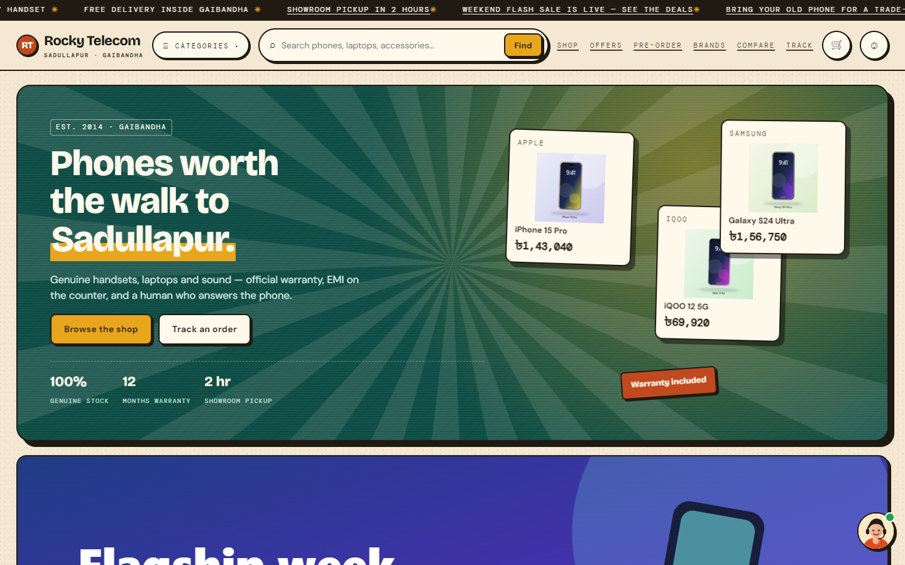
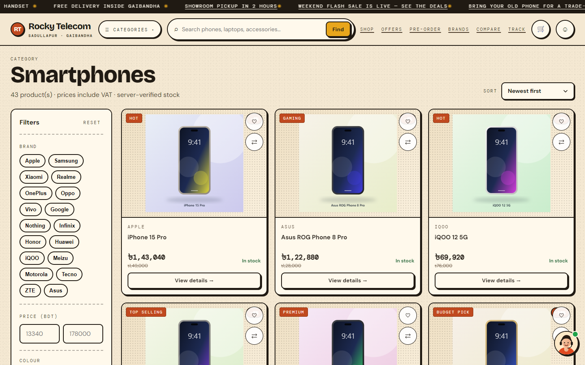
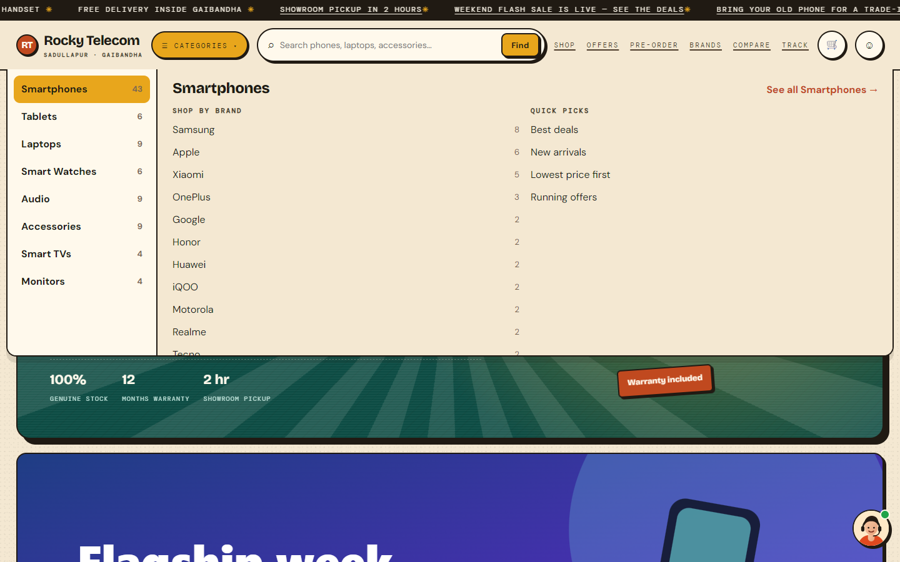
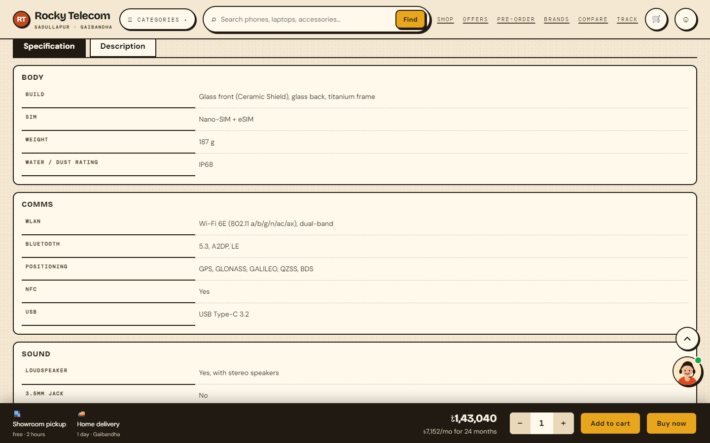
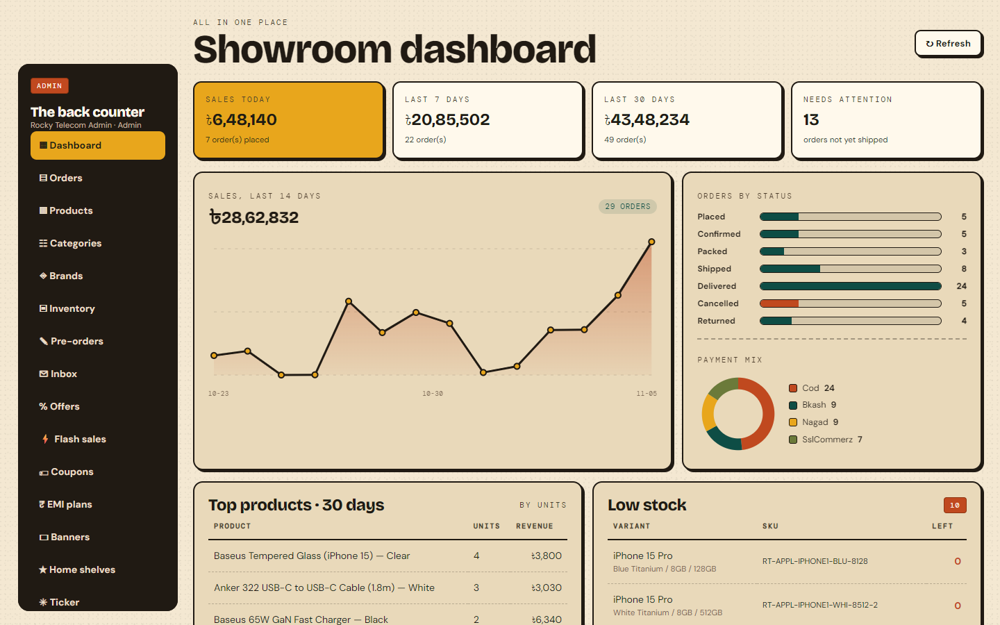
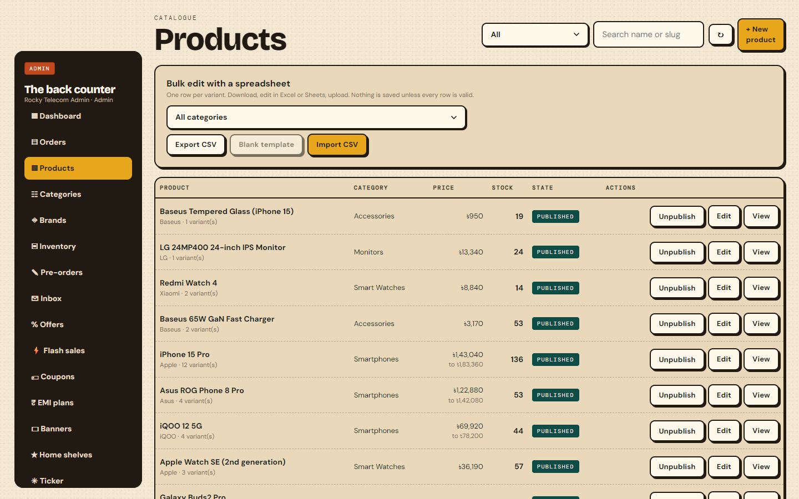
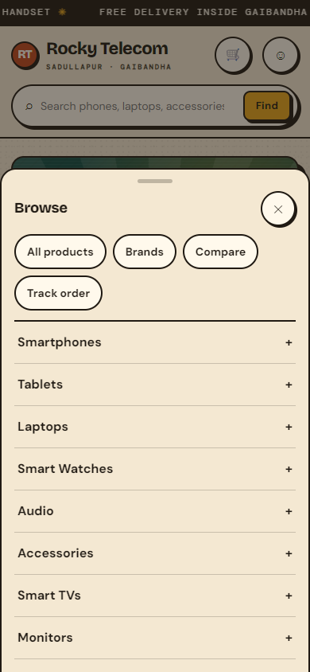

# Rocky Telecom — Phone & Electronics Shop, Online

<p align="center">
  
  
  
  
  
</p>

<p align="center"><b>A complete e-commerce platform for a real phone showroom in Gaibandha, Bangladesh — storefront, admin panel and API in one repository.</b></p>

<p align="center">Catalogue • Smart filters • Compare • EMI • Offers & flash sales • Pre-order • COD / bKash / Nagad / SSLCommerz • Order tracking • Admin panel • CSV import</p>

<p align="center">
  
</p>

---

## Table of Contents

- [About the Project](#about-the-project)
- [Why I Built It](#why-i-built-it)
- [Who Will Use It](#who-will-use-it)
- [Why They Will Use It](#why-they-will-use-it)
- [Screenshots](#screenshots)
- [Key Features](#key-features)
- [Tech Stack](#tech-stack)
- [Architecture Overview](#architecture-overview)
- [Getting Started](#getting-started)
- [Configuration](#configuration)
- [Deploying with Docker](#deploying-with-docker)
- [Testing](#testing)
- [Security](#security)
- [Operations: backup and load testing](#operations-backup-and-load-testing)
- [Project Structure](#project-structure)
- [Roadmap](#roadmap)
- [Contributing](#contributing)
- [License](#license)
- [Author & Contact](#author--contact)

---

## About the Project

**Rocky Telecom** is the online store for a phone and electronics showroom in **Sadullapur, Gaibandha**. It is a full-stack system:

- a **server-rendered Angular storefront** that search engines can read,
- a **.NET 10 Web API** built with Clean Architecture, CQRS and MediatR,
- an **admin panel** where the shop team manages products, prices, stock, orders, offers and content.

The shop wanted something like the big national phone retailers (deep filters, spec sheets, EMI, offers) but with its own look and a human tone, and with the rule that prices and stock shown on the site are the ones the counter really has. Everything is built around that rule: **the server is the only authority on price and stock**; the browser never decides either.

The demo database ships with **~90 products across 8 categories**, generated artwork and a month of sample orders, so you can click through a believable shop the moment it starts. Prices and specifications in the demo data are indicative, not a live price list.

---

## Why I Built It

1. **A real shop, a real problem.** Customers in Gaibandha ask on the phone what is in stock and what a model costs. A site that always answers correctly saves the team hours every day.
2. **Specs people can compare.** Phone buyers compare chipset, camera, battery and storage. Spec data is template-driven per category, so every phone shows the same eleven groups in the same order and the compare page lines them up.
3. **Bangladesh-specific checkout.** Cash on delivery, bKash, Nagad, SSLCommerz, EMI with local banks, divisions/districts/thanas, and a free showroom pickup in two hours.
4. **A catalogue the staff can run alone.** Product editor, spec templates, image upload, CSV import/export with a row-by-row error report, offers, banners, blog and a review inbox, so nobody has to ask a developer to change a price.
5. **A production-shaped codebase.** Clean layers, validation on every command, audit log, rate limiting, security headers, Docker, CI and tests, because this is also my exercise in building software that can actually be deployed.

---

## Who Will Use It

- **Shoppers in Gaibandha and across Bangladesh** who want a genuine phone with warranty, a clear price and the option to pay later.
- **Showroom staff** who update stock, confirm orders and answer the phone.
- **The owner** who watches sales, low stock and inbox messages on the dashboard.
- **Corporate buyers** who need a quote for many devices (a dedicated form feeds the admin inbox).
- **Anyone trading in an old phone**, using the trade-in request form.

---

## Why They Will Use It

- **Honest numbers:** stock is checked live, and the price in the cart is recomputed by the server at checkout.
- **Filters that do not get in the way:** brand, price, colour swatches, memory and storage (sorted by real size, 4GB → 16GB, 128GB → 1TB), in-stock and on-offer.
- **Full spec sheets:** body, comms, sound, memory, battery, display, network, features, platform and both cameras, plus a description written from the product's own data and an FAQ.
- **Pay your way:** cash on delivery, bKash, Nagad, card (SSLCommerz sandbox) and EMI.
- **Works on a phone:** mobile-first layout, bottom navigation, category drawer, a sticky buy bar and 44px tap targets.
- **Always someone to ask:** a floating help button with call, WhatsApp, message and order tracking.

---

## Screenshots

<table>
  <tr>
    <td width="50%"><b>Shop with smart filters</b><br /></td>
    <td width="50%"><b>Mega menu</b><br /></td>
  </tr>
  <tr>
    <td width="50%"><b>Product page: spec sheet in groups</b><br /></td>
    <td width="50%"><b>Admin dashboard</b><br /></td>
  </tr>
  <tr>
    <td width="50%"><b>Admin: products, CSV import and export</b><br /></td>
    <td width="50%"><b>Mobile: category drawer and bottom nav</b><br /></td>
  </tr>
</table>

---

## Key Features

### 1. Storefront
- **Home:** hero banners, flash sale countdown, featured and new-arrival shelves, offers, brand strip, blog posts and a scrolling news ticker, all editable from the admin panel.
- **Catalogue:** one listing for `/shop`, `/category/:slug`, `/brands/:slug` and search. Filters by brand, price range, colour (swatches that group marketing names into real colours), memory, storage, stock and offers. Sorting by newest, price, popularity and discount. Shareable URLs.
- **Mega menu and mobile drawer:** categories with the brands in each, quick picks, and an accordion bottom sheet on phones. Bottom navigation: Home · Offer · Category · Pre-order · Profile.
- **Product page:** gallery, variant picker (colour, memory, storage), live stock, EMI table, delivery estimate, a spec sheet in eleven grouped cards, a Description tab (price, key features, why buy, FAQ, similar phones), reviews and a sticky purchase bar.
- **Compare** up to four products side by side, and a **wishlist**.
- **Search** with suggestions, typo tolerance, recent and trending searches, and keyboard navigation.
- **Offers and pre-order:** campaigns with countdowns, a pre-order request flow for unreleased phones.
- **Cart and checkout:** guest or signed in, coupons, home delivery or showroom pickup, COD and gateway payments. Order numbers like `RT-261105-0001`, public order tracking by phone number.
- **Account:** profile, saved addresses, order history, OTP password reset.
- **Forms:** contact, trade-in, corporate quote, feedback, newsletter, all feeding one admin inbox.
- **Help button:** greeting, contact panel (call, WhatsApp, message, track order) and scroll-to-top.

### 2. Admin panel
- **Dashboard:** sales, orders, low stock and recent activity.
- **Product editor:** basics, variants (SKU, price, sale price, stock), image upload and reorder, specs from the category template. The **publish gate** refuses to publish until required specs, a priced variant and an image exist.
- **CSV import and export:** one row per variant, `spec:<key>` columns, a **dry run first**, and an **all-or-nothing import with a row-and-column error report**. Cells that start with `=`, `+`, `-` or `@` are neutralised against spreadsheet formula injection.
- **Categories and brands**, spec templates per category, inventory log with stock adjustments.
- **Orders** with status history, refunds and shipments; **pre-orders**; **reviews** moderation.
- **Marketing:** banners, flash sales, coupons, EMI plans, campaigns, ticker, home shelves, blog.
- **Inbox** for every customer form, **settings**, role-based access (Admin, Staff).

### 3. SEO and performance
- Server-side rendering, canonical tags, Open Graph, JSON-LD (Product, Breadcrumb, FAQ), `sitemap.xml` and `robots.txt`, SEO copy blocks on category pages with "Read more".
- Cached category tree and brand menus, image variants (thumb, medium, large) re-encoded to WebP.

### 4. Backend qualities
- Clean Architecture (Domain, Application, Infrastructure, Api), CQRS with MediatR, FluentValidation on every command, one response envelope `{ hasError, message, content }`.
- Idempotent order creation, atomic stock decrement with row versions, a 15-minute stock reservation that a background job releases, audit log, rate limiting, Serilog and a health check.

---

## Tech Stack

**Backend**
- .NET 10, ASP.NET Core Web API, MediatR 12, FluentValidation 12, EF Core 10 (SQL Server), ASP.NET Identity + JWT, Hangfire, Serilog, SixLabors ImageSharp

**Frontend**
- Angular 18 (standalone components, signals), Angular SSR on Express, custom CSS design system with CSS variables, no UI framework

**Data and infrastructure**
- SQL Server (LocalDB for development), Redis or in-memory cache, Docker Compose with nginx

**Quality**
- xUnit + FluentAssertions, ASP.NET `WebApplicationFactory` integration tests, Playwright end-to-end tests, GitHub Actions

---

## Architecture Overview

```
Browser ──► nginx ──► web-ssr (Angular SSR, Express) ──► API
                 └──────────────────────────────────────► API (/api, /uploads)
                                                           │
                                          SQL Server ◄─────┤
                                          Redis (cache) ◄──┘
```

- `RockyTelecom.Domain`: entities, enums, value objects (`Slug`), business rules such as the publish gate. No dependencies.
- `RockyTelecom.Application`: use cases as MediatR commands and queries, DTOs, validators, interfaces (`ICache`, `IImageStore`, `IPaymentGateway`…).
- `RockyTelecom.Infrastructure`: EF Core, migrations, Identity, caching, image storage, payment and courier adapters, the demo data seeder.
- `RockyTelecom.Api`: controllers, middleware (exception handling, correlation id, security headers), rate limiting, Swagger in development.
- `frontend/`: Angular app. `server.ts` is the SSR server that also serves `sitemap.xml`, `robots.txt` and a `/healthz` probe.

More detail lives in [`doc/ARCHITECTURE.md`](doc/ARCHITECTURE.md), [`doc/CONVENTIONS.md`](doc/CONVENTIONS.md) and the product requirements in [`doc/rocky-telecom-prd.md`](doc/rocky-telecom-prd.md).

---

## Getting Started

### Prerequisites

- [.NET 10 SDK](https://dotnet.microsoft.com/download)
- [Node.js 22+](https://nodejs.org/) and npm
- SQL Server LocalDB (installed with Visual Studio) or any SQL Server instance

### Run locally

1. Clone the repo:
   ```bash
   git clone https://github.com/InfinityAbir/Rocky-Telecom-Ecommerce.git
   cd Rocky-Telecom-Ecommerce
   ```
2. **One click on Windows:** run `start.bat`. It starts the API on `http://localhost:5129` and the web app on `http://localhost:4200`.

   **Or by hand:**
   ```bash
   # terminal 1: API (applies migrations and seeds the demo catalogue on first start)
   cd backend/RockyTelecom.Api
   dotnet run --urls http://localhost:5129

   # terminal 2: web app
   cd frontend
   npm ci
   npm start
   ```
3. Open **http://localhost:4200**. The admin panel is at **/admin**.

### Demo admin account (development only)

| | |
|---|---|
| Phone | `01700000000` |
| Password | `Rocky#2026` |

These values come from `appsettings.Development.json` and exist only when the API runs in Development. A production build never creates a known password (see [Security](#security)).

---

## Configuration

| Setting | Where | Purpose |
|---|---|---|
| `ConnectionStrings:Default` | `appsettings*.json` / env | SQL Server connection |
| `Jwt:Key` | env | Token signing key, 32+ characters, required |
| `Cache:Provider` | env | `memory` (default) or `redis` |
| `Payment:Provider` | env | `mock` (default) or a gateway; real gateways stay off until merchant approval |
| `Seed:Enabled` / `Seed:RunDemoCatalog` | env | Demo data and the seeded admin, for development and staging only |
| `Database:MigrateOnStartup` | env | Apply migrations on boot (Docker first run) |
| `SITE_URL`, `PUBLIC_API_ORIGIN`, `API_INTERNAL_URL` | web app env | Sitemap origin, browser API origin, server-side API address |

Copy `.env.example` to `.env` for Docker and fill in the secrets. `.env` is git-ignored.

---

## Deploying with Docker

```bash
cp .env.example .env          # set SITE_URL, SQL_SA_PASSWORD, JWT_KEY
mkdir -p deploy/certs         # put fullchain.pem and privkey.pem here
docker compose up -d --build
```

The stack is `nginx → web (SSR) + api → sql + redis`. nginx redirects HTTP to HTTPS, sends HSTS, rate-limits `/api` and the login endpoints harder, and caches uploaded images for 30 days. Health checks gate start-up order. See [`docker-compose.yml`](docker-compose.yml) and [`deploy/nginx.conf`](deploy/nginx.conf).

---

## Testing

| Suite | Count | Command |
|---|---|---|
| Unit (domain rules, CSV parser, injection guard) | 42 | `dotnet test backend/tests/RockyTelecom.UnitTests` |
| API integration (real HTTP pipeline, real database) | 9 | `dotnet test backend/tests/RockyTelecom.IntegrationTests` |
| End-to-end, Playwright (storefront, admin, mobile) | 16 | `cd frontend && npm run e2e` |

Integration tests use LocalDB, or the SQL Server named in `TEST_SQL_CONNECTION`, and skip themselves (not fail) when no server is reachable. The end-to-end suite needs the stack running; the order-placing test runs in CI or with `E2E_PLACE_ORDER=1`.

GitHub Actions ([`.github/workflows/ci.yml`](.github/workflows/ci.yml)) builds and tests the backend, builds the frontend and checks the security headers, then runs Playwright against a SQL Server service container.

To regenerate the README screenshots: `cd frontend && node e2e/capture-screenshots.mjs`.

---

## Security

- **Headers:** the API sends `nosniff`, `X-Frame-Options: DENY`, a locked-down CSP, `Referrer-Policy` and `Permissions-Policy`. The storefront adds a CSP that allows scripts from its own origin only (no inline or remote scripts).
- **HTTPS:** HSTS (one year, including subdomains) from nginx, the SSR server and the API when behind a TLS proxy; forwarded headers are honoured.
- **Auth:** ASP.NET Identity password hashing, JWT, lockout after 5 failed sign-ins (15 minutes), short-lived OTPs with attempt caps, role-based authorisation.
- **Abuse limits:** rate-limit policies for login, OTP, search suggestions and public forms.
- **Uploads:** content type and size whitelist, images fully re-encoded to WebP so a disguised file can never be served as-is.
- **Money:** prices, stock and totals are computed on the server; gateway callbacks are verified server-to-server.
- **CSV:** import is validated end to end before anything is written; exported cells are protected against formula injection.
- **Production start-up** never creates a known admin password; the seeder only runs when explicitly enabled.

---

## Operations: backup and load testing

- `ops/backup-sql.sh` takes a compressed, checksummed SQL Server backup, verifies it, and keeps 14 days. `ops/restore-sql.sh` restores into a scratch database so a backup can be proven without touching production. Schedule the first with cron.
- `ops/load-test.js` is a dependency-free load test for the read paths a shopper uses. On a development laptop (LocalDB, in-memory cache, 40 concurrent clients, 12 s) it sustained about **960 requests/second** with a **p95 of about 150 ms** and no errors. Run it against your own environment before launch: `node ops/load-test.js http://localhost:5129 40 12`.

---

## Project Structure

```
Rocky-Telecom-Ecommerce/
├── backend/
│   ├── RockyTelecom.Domain/          # entities, value objects, rules
│   ├── RockyTelecom.Application/     # MediatR use cases, DTOs, validators
│   │   └── Features/                 # Catalog, Admin, Orders, Offers, Search, Seo, ...
│   ├── RockyTelecom.Infrastructure/  # EF Core, migrations, services, demo seeder
│   ├── RockyTelecom.Api/             # controllers, middleware, Program.cs
│   ├── tests/                        # unit + integration tests
│   └── Dockerfile
├── frontend/
│   ├── src/app/
│   │   ├── core/                     # api client, services, models
│   │   ├── layout/                   # header, mega menu, bottom nav, help widget
│   │   ├── features/                 # home, catalog, product, cart, checkout, account ...
│   │   └── admin/                    # admin panel screens
│   ├── e2e/                          # Playwright tests and screenshot script
│   ├── server.ts                     # SSR server, sitemap, security headers
│   └── Dockerfile
├── deploy/nginx.conf
├── ops/                              # backup, restore, load test
├── doc/                              # PRD, architecture, conventions, decisions
├── docs/screenshots/                 # images used in this README
├── docker-compose.yml
└── .github/workflows/ci.yml
```

---

## Roadmap

- [ ] Real payment gateway credentials and production go-live checklist
- [ ] Courier integration (the mock courier is in place)
- [ ] Sub-categories seeded for the demo catalogue (the mega menu already supports them)
- [ ] Bangla language switch for the storefront
- [ ] Order and stock notifications by SMS
- [ ] Load test against a production-like environment and a restore drill on real data

---

## Contributing

1. Fork the repo
2. Create a feature branch: `git checkout -b feature/your-feature`
3. Make the change with tests, and run `dotnet test` and `npm run build`
4. Commit and open a Pull Request with a screenshot for any UI change

Please follow [`doc/CONVENTIONS.md`](doc/CONVENTIONS.md): the response envelope, kebab-case routes, validators on every command, server-side price and stock authority, and 44px tap targets.

---

## License

This project is currently **All Rights Reserved**: the source is available for learning and review. If you want to reuse code, please contact the author. A formal open-source licence can be added on request.

---

## Author & Contact

**Abir Hasan (InfinityAbir)**: ASP.NET Core / Android developer, building clean, secure, real-world apps.

- GitHub: https://github.com/InfinityAbir
- Portfolio: https://infinityabir.github.io/abir-hasan-portfolio/
- LinkedIn: https://www.linkedin.com/in/infinityabirhasan/
- Email: abirha3896@gmail.com

> If this project helps you, please ⭐ star the repo and share feedback via Issues.
